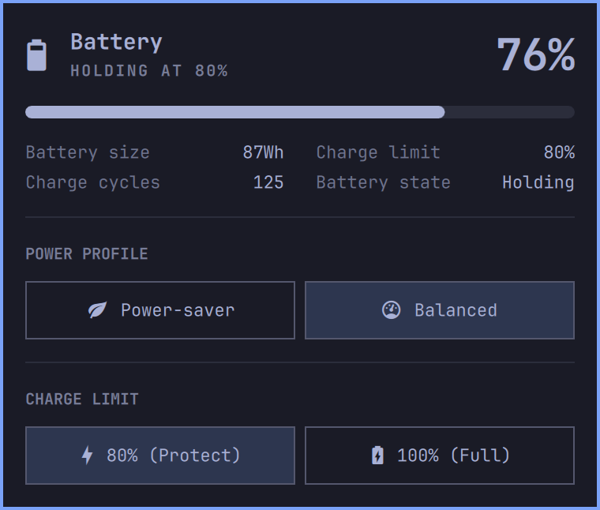

# Battery Health & Power for Omarchy

[](https://coderabbit.ai)

A polished, native Omarchy status bar panel and widget providing advanced battery health management, 80% charge threshold limiting, power profile switching, configurable bar display modes (`both`, `percentage`, `usage`), and live Apple Silicon SMC & ThinkPad RAPL + Hybrid NVIDIA RTX / Intel Arc GPU & UI policy telemetry.

<p align="center">
  <b>80% Charge Limiting (Protect Mode)</b> • <b>Power Profiles & Hybrid GPU Policy</b> • <b>Configurable Bar Display (% · W)</b> • <b>Live SMC & RAPL/dGPU Telemetry</b>
</p>

<p align="center">
  
</p>

---

## Features

- **Configurable Bar Display Modes (`both`, `percentage`, `usage`)**:
  - **`both`** (`Both (% · W)`): Shows battery percentage and live system usage wattage side-by-side (e.g. `80% · 32W`).
  - **`percentage`** (`Percent (%)`): Shows battery percentage only (e.g. `80%`).
  - **`usage`** (`Usage (W)`): Shows live system power usage only (e.g. `32W`).
  - Switchable via the popup panel (`BAR DISPLAY` section), right-clicking the bar widget, IPC (`omarchy-shell nertwork.power setDisplayMode both|percentage|usage`), or persistent state in `~/.local/state/omarchy/settings/nertwork.power.json` and `~/.config/omarchy/shell.json`.
- **Battery Health & Charge Threshold Limiting**:
  - One-click toggling between **80% (Protect)** and **100% (Full)** charge thresholds.
  - Extends lithium-ion battery longevity by preventing long stays at maximum voltage while docked or connected to AC power.
  - Automatic detection of hardware sysfs threshold nodes (`macsmc-battery`, `BAT0`, `BAT1`).
  - Native desktop notifications confirming threshold transitions.
- **Cross-Platform Live System Wattage & Hybrid GPU Telemetry (`v1.2+`)**:
  - **Total System Load (`W`)**: Real-time system power draw (`macsmc_hwmon` on Apple Silicon; Intel RAPL `psys`/`package-0` + D3cold-safe NVIDIA dGPU telemetry on ThinkPad P1 / x86_64) displayed continuously—even when plugged into AC and holding at the 80% or 100% charge threshold.
  - **AC Input Power & PD Adapter Limit**: Live AC wall/USB-C input wattage paired with negotiated USB-C Power Delivery adapter wattage limit (`macsmc-ac` / `ucsi-source-psy-*`).
  - **Charger Voltage & Amperage**: Negotiated USB-C PD input voltage (`V`) and current limit (`A`).
  - **Internal Rails / CPU & dGPU Breakdown**: Live `3.8V Rail` & `Heatpipe` power on Apple Silicon, or `CPU / dGPU` (`RAPL W · 0.0W (D3cold)` / active `nvidia-smi` draw) on ThinkPad P1.
  - **NVIDIA dGPU Status (`nvidia_gpu`)**: Live D3cold-safe telemetry row reporting either `Sleeping (RTD3 D3cold · 0W)` when suspended or live clock, VRAM usage, temperature, and P-state (`1500MHz · 1160MiB · 54°C (P3)`) when active.
  - **GPU / UI Policy (`gpu_mode`)**: Live readout of the active `omarchy-power-governor` hybrid graphics and UI offload state:
    - `Docked Perf (Arc 1.8GHz · RTX On-Demand)`: Intel Arc `gt0` 3D floor raised to `1800 MHz` (`2350 MHz` boost) with `Hyprland`, `quickshell`, and desktop apps running natively on Intel Arc for zero cross-GPU DMABUF copies and full blur/shadows/animations; NVIDIA RTX 3000 Ada kept in on-demand RTD3 (`auto`) for CUDA, AI inference, or `prime-run` workloads.
    - `Gaming (RTX Boost · UI Fast-Path)`: Triggered automatically by `omarchy-game-boost` when a game runs; keeps RTX 3000 Ada clocks locked (`1500–2500 MHz`) for the game while migrating `quickshell` back to the Intel Arc iGPU (`0 MiB` UI VRAM overhead on NVIDIA), lowering Arc `gt0` floor to `1000 MHz` to save package TDP headroom, and disabling Hyprland blur/shadows/animations.
    - `Docked Balanced (Arc iGPU · RTX Auto)`: `quickshell` and desktop apps run on Intel Arc (`1000 MHz` floor), NVIDIA RTX 3000 Ada unlocked and returned to RTD3 `auto` (`D3cold` `0W` when idle), Hyprland shadows disabled while keeping light blur (`passes=1`).
    - `Battery / Power-Saver (RTD3 D3cold)`: Intel Arc `gt0` floor at `RPn` (`800 MHz`), NVIDIA RTX in RTD3 `D3cold` (`0W`), and all Hyprland blur/shadows/animations disabled.
  - **Cooling Fan Telemetry**: Real-time fan RPM readout (`macsmc_hwmon` / `thinkpad_hwmon`).
  - **Battery Health, Temp & Voltage**: Live battery health percentage (`energy_full / energy_full_design`), cycle count, battery pack temperature (`°C`), and pack voltage (`V`).
  - **Instant Cache Invalidation**: `power-telemetry.sh` automatically invalidates its 2-second cache whenever `~/.local/state/omarchy/powerprofiles/last-profile` or `gpu-mode` is updated.
- **Power Profile Management**:
  - Seamless switching between `Power-saver`, `Balanced`, and `Performance` system profiles via `omarchy-power-governor`.
  - Full keyboard navigation and hotkey support inside the panel.
- **Fast Bar Controls**:
  - **Left-Click**: Toggle detailed popup panel.
  - **Middle-Click**: Instantly toggle charge limit between 80% and 100% without opening the panel.
  - **Right-Click**: Cycle top bar display mode (`both` → `percentage` → `usage`).

---

## Installation and Removal

Install directly into Omarchy using the `omarchy plugin` CLI:

```bash
omarchy plugin add https://github.com/nertwork/omarchy-battery-health.git --enable
```

To update to the latest version:

```bash
omarchy plugin update nertwork.power
```

To remove the plugin:

```bash
omarchy plugin remove nertwork.power
```

---

## Hardware Compatibility & Setup

### Apple Silicon (Asahi / Arch ARM Linux)
Charge limiting and live SMC telemetry are supported natively through `macsmc-battery`, `macsmc-ac`, `macsmc_hwmon`, and `tps6598x` sysfs controls:
```
/sys/class/power_supply/macsmc-battery/charge_control_end_threshold
/sys/class/power_supply/macsmc-battery/charge_control_start_threshold
/sys/class/power_supply/macsmc-ac/
/sys/devices/platform/soc/290400000.smc/macsmc-hwmon/hwmon/hwmon*/
```

### ThinkPad P1 & Standard Laptops (Intel RAPL + Hybrid NVIDIA dGPU / ACPI)
Charge thresholds, live power telemetry, and hybrid GPU policy states are supported via ACPI battery sysfs, USB-C UCSI power supply nodes, Intel RAPL (`intel-rapl:0`, `intel-rapl:1`), `thinkpad` hwmon, D3cold-safe PCI runtime PM checks, and `omarchy-power-governor` state files:
```
/sys/class/power_supply/BAT0/charge_control_end_threshold
/sys/class/power_supply/ucsi-source-psy-*/
/sys/class/powercap/intel-rapl:0/energy_uj
/sys/bus/pci/devices/0000:01:00.0/power/runtime_status
/var/lib/omarchy-power-profile/gpu-mode
~/.local/state/omarchy/powerprofiles/gpu-mode
```

---

## Shortcuts & IPC Controls

| Input / Command | Action |
|---|---|
| **Bar Left-Click** | Toggle the Power & Battery Health panel |
| **Bar Middle-Click** | Quick-toggle charge limit between 80% and 100% |
| **Bar Right-Click** | Cycle bar display mode (`both` → `percentage` → `usage`) |
| `omarchy-shell nertwork.power setDisplayMode both` | Show both percentage and live usage (`80% · 32W`) |
| `omarchy-shell nertwork.power setDisplayMode percentage` | Show percentage only (`80%`) |
| `omarchy-shell nertwork.power setDisplayMode usage` | Show live usage wattage only (`32W`) |
| `omarchy-shell nertwork.power cycleDisplayMode` | Cycle display mode |

---

---

## Related Omarchy Apps & Plugins by [`@nertwork`](https://github.com/nertwork)

| Project | Package / Plugin ID | Description |
| :--- | :--- | :--- |
| **[`nertwork/bluepill`](https://github.com/nertwork/bluepill)** | [`aur/bluepill`](https://aur.archlinux.org/packages/imsg) (`yay -S bluepill`) | **Native C++20 & Qt6/QML iMessage, SMS & RCS Desktop & CLI Client** for Omarchy & Hyprland — live `~/.config/omarchy/current/theme/colors.toml` theme sync, Omarchy Do Not Disturb integration, Socket.IO v4 push, HEIC/AVIF decoding, tapback reactions, and 2-tier split-window responsive UI. |
| **[`nertwork/omarchy-ai-agents`](https://github.com/nertwork/omarchy-ai-agents)** | `nertwork.agents` | Real-time status, rate-limit, and token usage bar panel for AI coding assistants (Claude Code, OpenAI Codex, GitHub Copilot, Grok, Antigravity). |
| **[`nertwork/omarchy-network-info`](https://github.com/nertwork/omarchy-network-info)** | `nertwork.network-info` | Unified network intelligence, public/LAN IP telemetry, Wi-Fi RSSI, and live interface bandwidth monitor for `omarchy-shell`. |
| **[`nertwork/omarchy-battery-health`](https://github.com/nertwork/omarchy-battery-health)** | `nertwork.power` | Battery health diagnostics, 80% charge threshold limiting, and real-time power draw analytics for Omarchy laptops. |
| **[`nertwork/omarchy-drawer`](https://github.com/nertwork/omarchy-drawer)** | `nertwork.drawer` | Foldable status bar drawer container for Omarchy widgets with smooth expand/collapse animations. |

---

## License

MIT License. See [LICENSE](LICENSE) for details.
