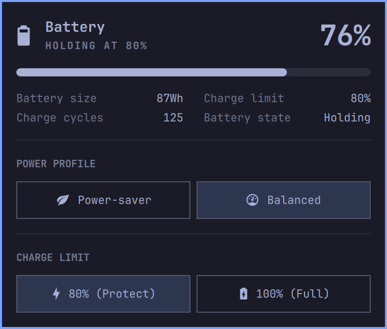

# Battery Health & Power for Omarchy

A polished, native Omarchy status bar panel and widget providing advanced battery health management, 80% charge threshold limiting, power profile switching, and live Apple Silicon SMC & system wattage telemetry.

<p align="center">
  <b>80% Charge Limiting (Protect Mode)</b> • <b>Power Profiles</b> • <b>Cycle Counts & Health</b> • <b>Live SMC & System Wattage Telemetry</b>
</p>

<p align="center">
  
</p>

---

## Features

- **Battery Health & Charge Threshold Limiting**:
  - One-click toggling between **80% (Protect)** and **100% (Full)** charge thresholds.
  - Extends lithium-ion battery longevity by preventing long stays at maximum voltage while docked or connected to AC power.
  - Automatic detection of hardware sysfs threshold nodes (`macsmc-battery`, `BAT0`, `BAT1`).
  - Native desktop notifications confirming threshold transitions.
- **Live Apple Silicon SMC & System Wattage Telemetry (`v1.1.0`)**:
  - **Total System Load (`W`)**: Real-time system power draw (`PSTR` / `macsmc-hwmon` or fallback calculation) displayed continuously—even when plugged into AC and holding at the 80% or 100% charge threshold.
  - **AC Input Power & PD Adapter Limit**: Live AC wall/USB-C input wattage (`PDTR`) paired with negotiated USB-C Power Delivery adapter wattage limit (e.g., `24.8 W / 140W PD`).
  - **Charger Voltage & Amperage**: Negotiated USB-C PD input voltage (`V`) and current limit (`A`) via `macsmc-ac` and `tps6598x` Type-C PD controllers.
  - **Internal Rails & Thermal Dissipation**: Live `3.8V Rail` power (`VR3R`) and heatpipe thermal dissipation power (`PHPC`).
  - **Cooling Fan Telemetry**: Real-time dual fan RPM readout (or `0 RPM (Passive)` when silent).
  - **Battery Health, Temp & Voltage**: Live battery health percentage (`charge_full / charge_full_design`), cycle count, battery pack temperature (`°C`), and pack voltage (`V`).
  - **Dynamic Bar Wattage**: Top bar badge automatically displays battery discharge/charge rate when cycling, or switches to live Total System Load (`W`) when plugged in and holding charge.
- **Power Profile Management**:
  - Seamless switching between `Power-saver`, `Balanced`, and `Performance` system profiles.
  - Full keyboard navigation and hotkey support inside the panel.
- **Fast Bar Controls**:
  - **Left-Click**: Toggle detailed popup panel.
  - **Middle-Click**: Instantly toggle charge limit between 80% and 100% without opening the panel.
  - **Right-Click**: Cycle top bar display mode through 4 presets:
    1. `% + W` (Percentage + Live Wattage)
    2. `%` (Percentage only)
    3. `Icon` (Icon only)
    4. `W` (Live Wattage only)
- **Seamless Omarchy Integration**:
  - Matches active system themes dynamically with responsive palette blending.
  - Drop-in replacement for the stock `omarchy.power` widget with identical bar ergonomics.

---

## Installation and Removal

Install directly into Omarchy using the `omarchy plugin` CLI:

```bash
omarchy plugin add https://github.com/nertwork/omarchy-battery-health.git --enable
```

To update to the latest version:

```bash
omarchy plugin update nertwork.power
```

To remove the plugin:

```bash
omarchy plugin remove nertwork.power
```

---

## Hardware Compatibility & Setup

### Apple Silicon (Asahi / Arch ARM Linux)
Charge limiting and live SMC telemetry are supported natively through `macsmc-battery`, `macsmc-ac`, `macsmc_hwmon`, and `tps6598x` sysfs controls:
```
/sys/class/power_supply/macsmc-battery/charge_control_end_threshold
/sys/class/power_supply/macsmc-battery/charge_control_start_threshold
/sys/class/power_supply/macsmc-ac/
/sys/devices/platform/soc/290400000.smc/macsmc-hwmon/hwmon/hwmon*/
```

### Standard Laptops (ThinkPad, Dell, Framework, ASUS)
Standard Linux laptops expose charge thresholds and power telemetry via ACPI / kernel modules:
```
/sys/class/power_supply/BAT0/charge_control_end_threshold
/sys/class/power_supply/BAT1/charge_control_end_threshold
```

---

## Shortcuts & Controls

| Input | Action |
|---|---|
| **Bar Left-Click** | Toggle the Power & Battery Health panel |
| **Bar Middle-Click** | Quick-toggle charge limit between 80% and 100% |
| **Bar Right-Click** | Cycle bar display mode (`% + W` → `%` → `Icon` → `W`) |
| **`h` / `l` or `Left` / `Right`** | Select power profiles (inside panel) |
| **`Enter`** | Activate selected power profile |
| **`Esc`** | Close panel |

---

## License

MIT License. See [LICENSE](LICENSE) for details.
